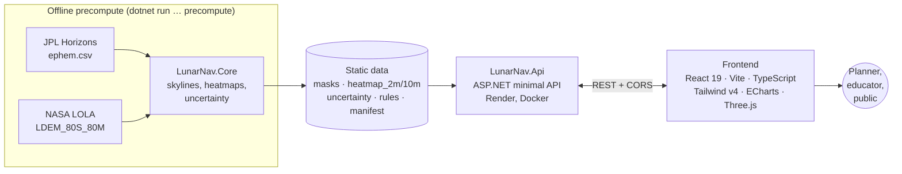

<div align="center">

# 🌙 LunarNav

### *Your launch slipped two weeks. Where on the Moon do you land now?*

**Lunar Landing Site Navigator** — built by **HagraCorp** (Sherbrooke, Québec) for the **NASA Space Apps Challenge 2026**.

[](https://github.com/saadtoury-Personal/HagraCorp/actions/workflows/ci.yml)


[**API & Swagger**](https://lunarnav-api.onrender.com/swagger) · [**The challenge**](https://www.spaceappschallenge.org/2026/challenges/lunar-landing-site-navigator/) · [**Validation report**](docs/validation.md) · [**Frontend architecture**](docs/frontend-architecture.md)

</div>

---

## Table of contents

1. [The problem, in one minute](#-the-problem-in-one-minute)
2. [What LunarNav does](#-what-lunarnav-does)
3. [A tour of the app](#-a-tour-of-the-app)
4. [How the answer is computed](#-how-the-answer-is-computed)
5. [Can you trust it? Validation](#-can-you-trust-it-validation)
6. [Architecture](#-architecture)
7. [Repository map](#-repository-map)
8. [Quick start](#-quick-start)
9. [The API](#-the-api)
10. [Data and how to regenerate it](#-data-and-how-to-regenerate-it)
11. [The 32 sites](#-the-32-sites)
12. [Rules, assumptions and honest limits](#-rules-assumptions-and-honest-limits)
13. [Testing](#-testing)
14. [Deployment](#-deployment)
15. [Workflow and contributing](#-workflow-and-contributing)
16. [The team](#-the-team)
17. [Sources and credits](#-sources-and-credits)

---

## 🎯 The problem, in one minute

The Moon's south pole is where everybody wants to go next: water ice, long-lived sunlight on a few ridges, and the Artemis and CLPS missions. It is also a brutal place to plan a landing.

- The Sun **skims the horizon** and never climbs more than a degree or two, so every hill and crater rim throws a shadow.
- The **Earth** is the only radio relay you can count on, and it only counts if it is above the local skyline.
- **Move 80 metres** and the sunlight can change by 20 to 60 percentage points. **Move the date** by two weeks and a site that looked perfect goes dark.

The existing tools (NASA QuickMap, Moon Trek, JPL Horizons) are powerful but built for specialists. Answering *"is this site viable on this date, and what is the next best one if we slip?"* takes several tools, raw data, and hours.

**LunarNav answers it in about 35 milliseconds.**

> *Missions to the Moon's south pole face extreme lighting and communication constraints... Your challenge is to create an intuitive tool that lets mission planners, educators, and the public compare landing sites and dates quickly.*
> — the Space Apps challenge ([full text](Challenge.md))

---

## ✨ What LunarNav does

| | Feature | Why it matters |
|---|---|---|
| 🛰️ | **Slip Navigator** — drag "the launch slips by X weeks" and see which of the 32 sites still work, the best fallback, and how many extra days each site can tolerate | The question mission planners actually ask when hardware is late |
| 🌍 | **3D globe** — a real Moon with the Sun and the Earth in their true directions, zoom to any of the sites | Understand the geometry before reading a single number |
| 🏔️ | **Real horizons** — a 720-direction skyline per site, ray-cast from NASA LOLA terrain out to 250 km | The Moon has no atmosphere: the skyline *is* the shadow |
| ☀️ | **Sun and Earth timelines** — hours of sunlight, Earth-link windows, countdown to sunset and Earthset, longest dark spell | Power and direct-to-Earth communication at a glance |
| 🔋 | **Battery simulation** — hour-by-hour state of charge for your panel, load and battery | Replaces arbitrary "6 hours of dark is OK" with physics |
| 🎯 | **Landing accuracy** — what if you land 100, 250 or 500 m off target? Min / max sunlight around the official point | Shows why a few hundred metres can change everything |
| 🧱 | **What hides the Sun** — which azimuths block sunlight, and how much the terrain costs versus a flat horizon | Explains *why* a site is good or bad |
| 📊 | **Compare** — site × date grid for your mission (duration, minimum sunlight, minimum Earth link, mast height), three best windows, ranking that holds over **2,000 random weightings** | No hand-picked weights to argue about |
| ✅ | **GO / RISKY / NO-GO verdicts** with the reasons, and a **close call** badge when a ±0.2° skyline error could flip the answer | Honest about uncertainty instead of a falsely precise number |
| 🔗 | **Shareable links** — the whole scenario (site, date, slip, stay, mast, rules) lives in the URL | Send a colleague the exact view |
| 📥 | **CSV export** of any site's hourly series | For the spreadsheet people |
| 📍 | **Custom point** — any coordinates south of 80.5°S, horizon computed live from the terrain in ~60–100 ms | Not limited to our list |
| 🌓 | **Moon phase** from NASA's Dial-A-Moon | Because it is lovely |
| 🔍 | **Method page** — rules, sources, validation, limits and a glossary, in plain words | Accessible to educators and the public |

Built for three audiences: **mission planners** (fast, technical), **educators** (explainable), and **the curious public** (visual, no jargon required).

---

## 🗺️ A tour of the app

| Page | Route | What you do there |
|---|---|---|
| **Globe** | `/` | Spin the Moon, watch the Sun and Earth sit where they really are, pick one of the 32 regions |
| **Site** | `/site` | One site over time: sunlight and Earth-link shares, horizon panorama with Sun and Earth tracks, landing accuracy within 500 m, blockers, battery over your stay |
| **Compare** | `/compare` | Grid of sites by start date for a mission profile, top three windows, robust ranking |
| **Slip** | `/slip` | "If the launch slips N weeks": surviving sites, best fallback, and when the original site works again |
| **Method** | `/method` | Rules, data sources, validation against NASA, limits, glossary |
| **Contact** | `/contact` | The six of us |

Design principles (see [`PRODUCT.md`](PRODUCT.md)):

1. **A readable answer before the detail** — verdict first, curves after.
2. **One shared time** — the date slider drives the globe, the terrain and every indicator.
3. **Scientific honesty** — every value is labelled *Server*, *Bundled data* or *Assumed*, with its source.
4. **The image carries the page** — the interface stays in the background.

Accessibility is a requirement, not a nice-to-have: AA contrast, colour-blind-safe palette where **colour is never the only signal**, full keyboard navigation, 44 px touch targets, phone layout without horizontal scroll, and `prefers-reduced-motion` respected.

---

## 🧮 How the answer is computed

```
 JPL Horizons ──► where are the Sun and the Earth in the Moon's sky, every hour, 2026–2030
 NASA LOLA   ──► 80 m terrain around the pole ──► ray-cast a 720-point skyline per site and mast
                                   │
                  Sun/Earth disc vs skyline, 16 vertical strips, true angular size
                                   ▼
        visible fraction of each disc, every hour  ──►  windows, shares, countdowns,
                                                        battery, heatmap, verdicts
```

1. **Ephemeris.** Hourly Sun and Earth directions from **JPL Horizons (DE441)** in the Moon Mean Earth frame — 43,825 samples from 2026 to 2030. Libration and orbital variation are included because they come straight from Horizons.
2. **Skyline.** For each site and each mast height (2 m and 10 m) the engine casts rays over **720 azimuths** (every 0.5°) across **LOLA LDEM_80S_80M** (80 m per pixel, out to 250 km), keeping the highest angular elevation, curvature of the Moon included. No atmosphere, so no refraction.
3. **Visible fraction.** The Sun's or Earth's disc is cut into **16 vertical strips**, each compared to the skyline at *its own* azimuth. The Sun's apparent size follows its real distance; Earth-in-front-of-Sun eclipses are removed.
4. **Windows.** *Sun up* = the upper edge clears the skyline. *Earth in view* = any part of the disc clears it. Dark gaps of **6 hours or less** are bridged (a battery covers them).
5. **Metrics.** Shares of the stay, longest dark spell, the **VIPER rule** (more than **50 h** with the Sun *and* the Earth down is fatal for a solar rover), countdowns, and a power index.
6. **Slip.** The heatmap stores, for every site and day, *how many continuous hours* of Sun (and Sun + Earth) start that day. A site is viable if `hours ≥ stayDays × 24`. One file serves every stay length, which is why re-ranking 32 sites for a slipped date takes ~35 ms.
7. **Robust ranking.** Non-dominated sites over (Sun, Earth, longest night) plus rank stability over **2,000 random weight sets** — "this site ranks first under most weightings" beats an arbitrary score.
8. **Uncertainty.** The skyline is recomputed on points around the official coordinates (100 m, 250 m and 500 m rings); the app shows the min–max alongside the official value.

Everything lives in [`LunarNav/LunarNav.Core`](LunarNav/LunarNav.Core) (`Ephemeris`, `Terrain`, `Geometry`, `Analysis`, `Models`).

### The punchline numbers

- **Mast height:** at Connecting Ridge, 2 m → 10 m raises sunlight from **45 % to 85 %**.
- **Position:** our *Shackleton Rim* point gets **9 %** sunlight; the best point on that rim, **2 km** away, gets **85 %**.
- **Date:** a 1 March 2027 landing slipping two weeks leaves **one** viable site out of 32 with Sun + Earth: the Mons Mouton plateau, with a **341 h** window, tolerating only **4 more days** of delay. LunarNav finds it instantly.

---

## ✅ Can you trust it? Validation

We validated the **product's own C# code** against NASA's official illumination maps (**PGDA product 69**, E. Mazarico, Goddard), with **success thresholds committed before the first run** ([`tools/validation/thresholds.json`](tools/validation/thresholds.json)).

| Check | Result |
|---|---|
| Sites compared with NASA PGDA | **31** |
| Median gap, Sun / Earth | **0.78 / 0.74 points** |
| Sites within ±5 points, Sun | **26 / 31** (threshold ≥ 25) |
| Sites within ±5 points, Earth | **28 / 31** (threshold ≥ 27) |
| Unexplained gaps | **0** |
| Sun and Earth directions vs JPL Horizons | within **0.006°** (unit-tested; a 0.1° frame shift is caught) |
| Independent re-implementation (Python) | **0.00 points** gap once the three C# refinements are ported (93 / 93 rows) |
| Published paper (Gläser et al. 2014, Connecting Ridge) | 2 m: 92.3 % vs ours 89.8 %; 10 m: 95.7 % vs 93.5 % |

All eight larger gaps sit on **ridges and plateau edges**, where NASA's own map swings 20–60 points between neighbouring pixels.

### What we are not hiding

We keep failures visible, because that is what validation is for:

- ❌ Our first C# vs Python comparison **missed its 0.05-point threshold** (Sun 0.08, Earth 0.42). Cause found and verified; the original failure stays on the record.
- ❌ Two of three **negative controls** (Sun rotated 180°, date + 14.77 days) *still pass* — because a 5-year average is nearly blind to *when* the Sun passes. This comparison validates the **horizon geometry, not the calendar**. The calendar is validated against JPL Horizons.
- ⚠️ NASA and LunarNav use the **same terrain (LOLA)**: we validate the method, not the terrain.
- ⚠️ NASA averages 18.6 years; we cover 2026–2030. Year-to-year variation is 2–3 points.

Full report: [`docs/validation.md`](docs/validation.md) · live at `GET /api/validation` · reproducible with the [`validate`](#-data-and-how-to-regenerate-it) command.

---

## 🏗️ Architecture



**Design stance:** the frontend is a **static single-page app**. No database, no server-side rendering, and it never calls Horizons from the browser. It bundles the ephemeris window and the skylines, does only cheap maths locally (countdowns, ranking for a slipped date), and asks the API for the server-computed figures and for custom coordinates.

| Layer | Tech |
|---|---|
| Science and API | **C# / .NET 11**, ASP.NET minimal API, OpenAPI + Swagger UI, xUnit |
| Frontend | **React 19**, **TypeScript**, **Vite**, **Tailwind CSS v4**, **React Router**, **Zustand** (state synced to the URL), **Apache ECharts**, hand-written SVG for the horizon panorama |
| 3D | **Three.js** via **React Three Fiber** + **drei**, lazy-loaded (NASA LRO Moon, Earth and Sun models in `frontend/public/models`) |
| Tests | xUnit (backend), Vitest (frontend), `oxlint` |
| Python tooling | Ephemeris fetch and independent validation scripts (`tools/`) |
| CI/CD | GitHub Actions, Docker, Render (API), static hosting (frontend) |

---

## 📁 Repository map

```
HagraCorp/
├── LunarNav/                        # .NET solution (LunarNav.slnx)
│   ├── LunarNav.Core/               # science: Ephemeris, Terrain, Geometry, Analysis, Models
│   ├── LunarNav.Core.Tests/         # unit tests (JPL match, horizon, DEM, gaps, geometry, moon phase)
│   ├── LunarNav.Api/                # minimal API + CLI: precompute | validate | manifest
│   │   ├── Program.cs               # endpoints and CLI entry points
│   │   ├── Tools.cs                 # precompute and manifest writer
│   │   ├── Validation.cs            # runs the product code against NASA PGDA
│   │   ├── AppData.cs, MoonService.cs
│   │   └── LunarNav.Api.http        # ready-made requests
│   ├── LunarNav.Tests/              # API and validation integration tests
│   ├── LunarNav.Web/                # original Blazor client; wwwroot/data holds the precomputed JSON
│   ├── Dockerfile                   # API image (downloads the 115 MB LOLA terrain at build)
│   └── LunarNav.slnx
├── frontend/                        # React + Vite app (the product UI)
│   ├── src/pages/                   # Globe, Site, Compare, Slip, Method, Contact
│   ├── src/features/                # globe/ (Three.js), site/ (horizon, battery, blockers, uncertainty)
│   ├── src/lib/                     # ephemeris, slip, metrics, rules, scenario links, API client
│   ├── src/store/                   # Zustand stores (scenario, server)
│   ├── src/data/                    # bundled masks, sites, ephemeris window, uncertainty
│   └── public/                      # 3D models, llms.txt, redirects
├── tools/
│   ├── fetch_ephem.py               # download Sun/Earth ephemeris from JPL Horizons
│   └── validation/                  # pgda.py · ours.py · ours_ported.py · compare.py · thresholds.json + results
├── docs/
│   ├── validation.md                # full validation report
│   ├── frontend-architecture.md     # frontend decisions and data contract
│   └── cours-backend-lunarnav.html  # backend course/walkthrough
├── design/mockup/                   # throwaway static HTML mockup
├── 3Dobjets/                        # source 3D models and the site coordinate table
├── .github/workflows/               # ci.yml · owner-approval.yml · keep-alive.yml
├── render.yaml                      # Render blueprint for the API
├── Challenge.md                     # the NASA Space Apps challenge text
└── PRODUCT.md                       # product brief, users, principles, accessibility
```

---

## 🚀 Quick start

### Prerequisites

| Tool | Version |
|---|---|
| .NET SDK | **11.0** (`.slnx` needs SDK ≥ 9.0.200) |
| Node.js | a recent LTS (the frontend uses Vite 8 and TypeScript 7) |
| Python | 3.x, only for `tools/` |

### 1. Run the API

```bash
git clone https://github.com/saadtoury-Personal/HagraCorp.git
cd HagraCorp
dotnet run --project LunarNav/LunarNav.Api
```

The API listens on **http://localhost:5204**, redirects `/` to **Swagger UI**, and serves the precomputed data from `LunarNav/LunarNav.Web/wwwroot/data`. Check it:

```bash
curl http://localhost:5204/api/health
```

> **Custom points need the LOLA terrain** (115 MB, too big for git). Without it the API still works; only `POST /api/custom` is unavailable. See [Data](#-data-and-how-to-regenerate-it).

### 2. Run the frontend

```bash
cd frontend
npm install
VITE_API_URL=http://localhost:5204 npm run dev
```

Leave `VITE_API_URL` unset to use the team's deployed API at `https://lunarnav-api.onrender.com`.

> ⏰ The deployed API runs on Render's free plan and **sleeps after 15 minutes**; the first call can take ~60 s. A GitHub Action pings it every 5 minutes to keep it awake.

### 3. Other frontend commands

```bash
npm run build     # type-check + production build
npm run lint      # oxlint
npm test          # vitest
npm run preview   # serve the production build
```

### 4. Configuration

| Setting | Where | Default |
|---|---|---|
| `DataDir` | API config / env | `LunarNav/LunarNav.Web/wwwroot/data` |
| `DemPath` | API config / env | `LunarNav/data/LDEM_80S_80M.IMG` |
| `VITE_API_URL` | frontend env | `https://lunarnav-api.onrender.com` |
| `ASPNETCORE_HTTP_PORTS` | Docker | `10000` |

No secrets are needed anywhere: the demo API is public and read-only.

---

## 🔌 The API

Base URL: `https://lunarnav-api.onrender.com` · interactive docs: **`/swagger`** · OpenAPI: `/openapi/v1.json`.

Conventions: angles in **degrees**, **longitude east-positive**, south pole latitude **−90**, times **UTC** (ISO 8601), JSON in **camelCase**, mast height **2** or **10** m.

| Endpoint | What it returns |
|---|---|
| `GET /api/health` | `{ "status": "ok", "sites": 32 }` |
| `GET /api/about` | Precision statements, sources, and every rule with its `assumed` / `validated` status |
| `GET /api/sites` | The 32 sites |
| `GET /api/sites/{id}/mask?mast=2` | The skyline: 720 elevations, one per 0.5° of azimuth |
| `GET /api/sites/{id}/metrics?at=&stayDays=&mast=` | Sun and Earth shares, countdowns (sunset, Earthset, sunrise, Earthrise), longest dark spell, VIPER-rule flag, windows, viability |
| `GET /api/sites/{id}/timeline?from=&days=30&stepMinutes=60&mast=` | Hourly Sun and Earth azimuth, elevation and visible fraction |
| `GET /api/sites/{id}/battery?at=&stayDays=&mast=&…` | Battery state-of-charge simulation |
| `GET /api/sites/{id}/uncertainty?mast=` | Sun/Earth/both share at the official point and its min–max around it |
| `GET /api/sites/{id}/blockers?from=&to=&mast=` | Which azimuths block the Sun, and what the terrain costs |
| `GET /api/sites/{id}/export.csv?from=&days=&mast=` | Hourly series as CSV |
| `GET /api/heatmap?mast=` | Sites × days grid of continuous Sun hours (`sunH`) and Sun + Earth hours (`bothH`) |
| `GET /api/fallback?date=&slipWeeks=&stayDays=&requireEarth=&mast=` | Sites ranked for the slipped date, with the verdict before and after the slip |
| `GET /api/ranking?date=&stayDays=&mast=` | Robust ranking over many random weightings |
| `POST /api/custom` | Any point south of 80.5°S, horizon ray-cast live from LOLA |
| `GET /api/moon?at=` | Moon phase (NASA Dial-A-Moon) |
| `GET /api/validation` | The published validation results |

**Try it:**

```bash
# Which sites survive a 2-week slip of a 1 March 2027 landing, for a 6-day stay with Earth contact?
curl "https://lunarnav-api.onrender.com/api/fallback?date=2027-03-01&slipWeeks=2&stayDays=6&requireEarth=true&mast=2"
```

Typical local response times (after warm-up): fallback for 32 sites **~35 ms**, ranking ~5 ms, one-site metrics ~25 ms, 30-day timeline ~3 ms, full heatmap ~18 ms, custom point ~60–100 ms.

---

## 🗃️ Data and how to regenerate it

All precomputed files live in [`LunarNav/LunarNav.Web/wwwroot/data`](LunarNav/LunarNav.Web/wwwroot/data) and are served as plain static files.

| File | Content |
|---|---|
| `sites.json` | The 32 sites (id, name, lat, lon, category, notes, `terrain` flag) |
| `masks/{id}_{mast}m.json` | 720-element skyline per site and mast |
| `heatmap_{mast}m.json` | `{ sites, days, sunH, bothH }`; viable ⇔ `hours ≥ stayDays × 24` |
| `uncertainty_{mast}m.json` | Sun/Earth/both share around the official point |
| `rules.json` | Every threshold, tagged `assumed` or `validated`, with a source |
| `validation.json` | Per-site comparison with NASA PGDA |
| `ephem.csv` | Hourly Sun/Earth ephemeris from JPL Horizons (DE441) |
| `manifest.json` | **SHA-256, source and generating command for every file** (traceability) |

**Regenerate everything**

```bash
# 1. Fetch the ephemeris from JPL Horizons
python tools/fetch_ephem.py

# 2. Get the LOLA terrain (115 MB, 80 m/pixel)
mkdir -p LunarNav/data
curl -fL -o LunarNav/data/LDEM_80S_80M.IMG \
  https://pds-geosciences.wustl.edu/lro/lro-l-lola-3-rdr-v1/lrolol_1xxx/data/lola_gdr/polar/img/ldem_80s_80m.img

# 3. Precompute skylines, heatmaps, uncertainty
dotnet run --project LunarNav/LunarNav.Api -- precompute LunarNav/data/LDEM_80S_80M.IMG LunarNav/LunarNav.Web/wwwroot/data

# 4. Refresh the SHA-256 manifest
dotnet run --project LunarNav/LunarNav.Api -- manifest LunarNav/LunarNav.Web/wwwroot/data
```

The three CLI verbs are `precompute <demPath> <dataDir>`, `manifest <dir>`, and `validate <demPath> <dataDir> <validationDir> <out.json> [ephem.csv]` (the last one runs the product code against the NASA PGDA references in `tools/validation/`). `manifest.json` records the exact command used for each file.

---

## 📍 The 32 sites

Coordinates come from NASA's Lunar Surface Data Book. 31 have real terrain; **Apollo 11** is kept as a flat-horizon equatorial reference and is excluded from rankings (a flat horizon must never beat a real one).

| Category | Sites |
|---|---|
| **Artemis III candidates** | Haworth, Malapert Massif, Malapert Crater 1, Mons Mouton, Mons Mouton Plateau, Nobile Rim 1 & 2, de Gerlache Rim 1 & 2, de Gerlache–Kocher Massif, Slater Plain, Amundsen Rim, Amundsen 1, Shackleton Rim B, Shoemaker and Shoemaker Rims A–F, Faustini Rim A, Cabeus Exterior Wall 1, Peak near Cabeus B, Peak near Shackleton, Idel'son L Crater 1, Leibnitz Beta Plateau, Connecting Ridge Extension |
| **CLPS** | Shackleton – de Gerlache Connecting Ridge |
| **International** | Shackleton Rim |
| **Failed landing** | IM-2 Athena (Mons Mouton) |
| **Apollo (reference)** | Apollo 11 |

Best sun, 2026–2029, 2 m mast: de Gerlache–Kocher Massif **78.8 %**, Peak near Shackleton **72.9 %**, Mons Mouton **65.5 %**, Nobile Rim 1 **65.4 %**, Malapert Massif **63.6 %** (with Earth in view **100 %** of the time). Worst: Amundsen 1 (**1.6 %**). Median across sites: 36 % Sun, 53 % Earth.

---

## 📏 Rules, assumptions and honest limits

Every rule is in [`rules.json`](LunarNav/LunarNav.Web/wwwroot/data/rules.json) and shown in the app tagged **assumed** or **validated**.

| Rule | Value | Status |
|---|---|---|
| Sun up | Upper edge above the terrain | assumed |
| Earth in view | Any part of the disc above the terrain (line of sight only — *not* a link budget) | assumed |
| Tolerated dark gap | 6 h | assumed |
| VIPER rule | > 50 h with Sun *and* Earth down | assumed (NASA VIPER planning) |
| Horizon error margin | ±0.2° | assumed |
| Default lander | 2 m² panel, 28 % efficient, 150 W load, 5 kWh battery, 20 % minimum charge | assumed |
| Verdict | **NO-GO** = not viable or VIPER rule broken · **RISKY** = viable but a close call · **GO** = viable and not a close call | assumed |
| Sun and Earth directions | match JPL Horizons within 0.006° | **validated** |

**Limits, said plainly:**

- No atmosphere means no refraction, and none is modelled.
- Terrain is **80 m per pixel**; ridges are sensitive to a single pixel.
- Mast heights are **2 m and 10 m**; the app interpolates between them, the API rounds.
- "Earth in view" is geometry, **not** a Deep Space Network link budget.
- The terrain itself is validated *by consistency* with NASA (same LOLA source), not independently.
- The ephemeris window is 2026–2030; NASA's maps average 18.6 years.
- The Apollo 11 point has no south-pole terrain map and is marked as such.
- All numbers are results of our model. Treat them as **exploration, not a mission decision**.

---

## 🧪 Testing

```bash
dotnet test LunarNav/LunarNav.slnx -c Release     # backend (78 tests at last count)
cd frontend && npm test                           # frontend: Vitest
```

Highlights:

- Sun and Earth directions checked against JPL Horizons (`SunAzEl_Haworth_MatchesJplHorizons`).
- A **frame shifted by 0.1°** must be detected.
- Horizon tests: smooth sphere, flat terrain, stepped horizon through a disc.
- Slip, gap and tolerance logic.
- Frontend: `ephemeris`, `slip`, `rules`, `sites`, `scenarioLink`, `earthOrientation`, globe models.
- API integration tests, including the validation endpoint.

CI runs restore → build → test on every push and pull request to `main` and `dev`.

---

## 🚢 Deployment

| Piece | Where | How |
|---|---|---|
| **API** | [Render](https://render.com) (Docker, free plan) | [`render.yaml`](render.yaml) blueprint; health check `/api/health`; the Dockerfile downloads the LOLA terrain and verifies its exact size, degrading gracefully (only custom points go off) if the download fails. **Render deploys from `main`.** |
| **Frontend** | Any static host (Vercel config included) | [`frontend/vercel.json`](frontend/vercel.json) and `public/_redirects` send every route to `index.html` for the SPA |
| **Keep-alive** | GitHub Actions | `keep-alive.yml` pings `/api/health` every 5 minutes so the free plan does not sleep |

Run the API container locally:

```bash
docker build -t lunarnav-api LunarNav
docker run -p 10000:10000 lunarnav-api
```

---

## 🤝 Workflow and contributing

- **Branches:** one branch per person, off `dev`. PRs go to `dev`.
- **`main` accepts PRs from `dev` only** — checked by the `source-branch` job in the `owner-approval` workflow.
- **Approval:** every PR needs a review from the repo owner (`.github/CODEOWNERS`, enforced by the branch ruleset). New commits dismiss the review, so approval is given again.
- **Before opening a PR:** all tests green (`LunarNav.Core.Tests` and `LunarNav.Tests`).
- **House rules:**
  - Never move an official site to its "best pixel" — show the gap instead.
  - Every displayed number comes from the API or the bundled data, never typed by hand.
  - No secrets, no local config files in commits.
  - Missing data is **unknown**, never "clear".

---

## 👥 The team

**HagraCorp** — six people from Sherbrooke.

| | Role | Owns |
|---|---|---|
| **Saad** | Tech lead, full-stack and ephemeris engineer | Architecture, Sun and Earth position engine, integration |
| **Edi** | Geospatial scientist, data validation lead | LOLA terrain, horizon masks, illumination and Earth-visibility windows, physical checks |
| **Youssef** | Frontend and data-visualization engineer | Charts, Slip and Compare pages, the 3D Earth and Sun |
| **Nizar** | Backend and API developer | The API, per-site precompute cache, deployment |
| **Nazim** | Frontend developer, UI/UX design | Design system, Globe and Site pages |
| **Maggie** | Mission domain specialist, pitch lead | Landing-site research, explanatory text, video, submission and pitch |

---

## 🙏 Sources and credits

- **NASA Space Apps Challenge 2026** — [Lunar Landing Site Navigator](https://www.spaceappschallenge.org/2026/challenges/lunar-landing-site-navigator/)
- **NASA LOLA** (Lunar Orbiter Laser Altimeter) `LDEM_80S_80M` terrain, via the PDS Geosciences Node
- **JPL Horizons** system (DE441 / DE421 ephemerides)
- **NASA PGDA** illumination products (product 69, E. Mazarico, Goddard) — validation reference
- **NASA SVS 5013** — Artemis III candidate regions; **NASA Dial-A-Moon** — Moon phase; **NASA LRO** 3D Moon model
- Gläser et al. (2014, 2018) and Mazarico et al. (2011) — published illumination studies
- NASA *Moon to Mars Architecture: Lunar Site Selection* white paper (2023)

---

## License

Copyright (C) 2026 the HagraCorp team.

LunarNav is free software, licensed under the [GNU Affero General Public License v3.0](LICENSE) (AGPL-3.0), an OSI-approved open-source license as required by the NASA Space Apps rules. You may use, modify and share it, but if you run a modified version as a network service, you must publish your source code under the same license.

For use under different terms (for example, a commercial license), contact the team.

Third-party data and models keep their own terms; see *Sources and credits* above.

---

<div align="center">

*Small changes, big effects. That is the whole Moon in one sentence.* 🌑→🌕

**Built with caffeine, ray-casting, and a stubborn respect for shadows.**

</div>
